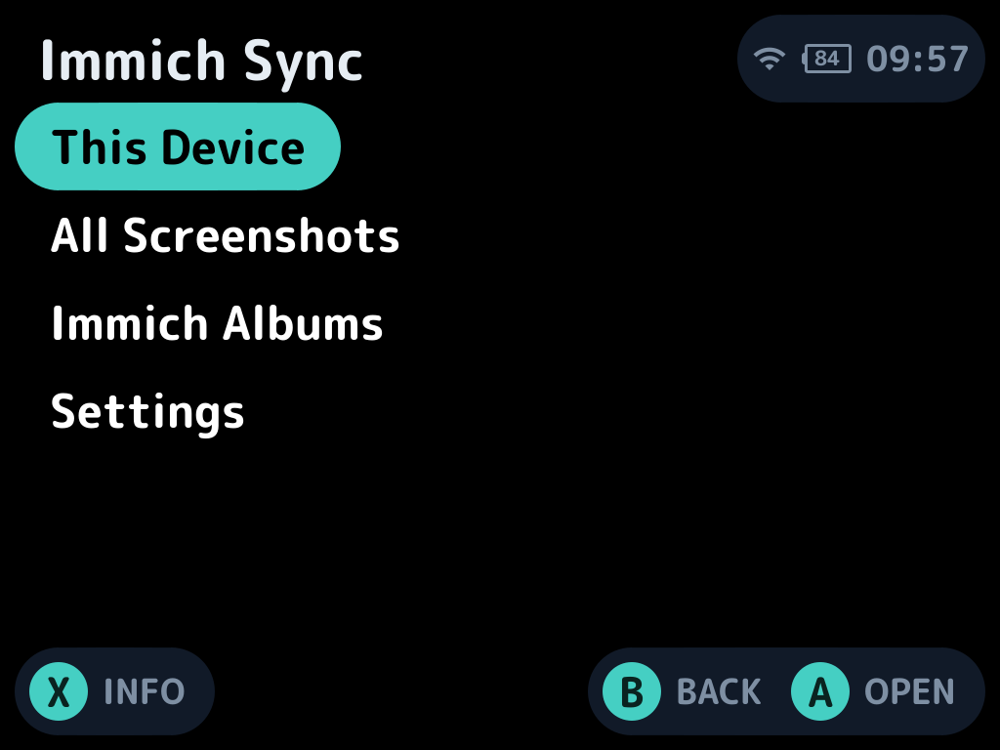
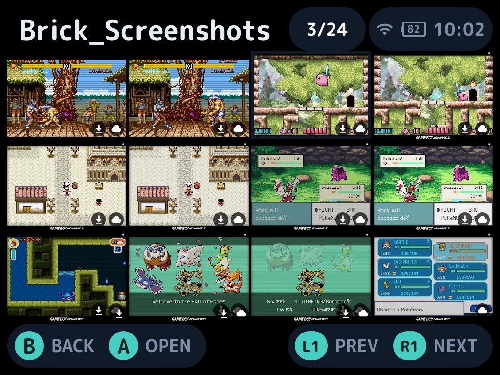
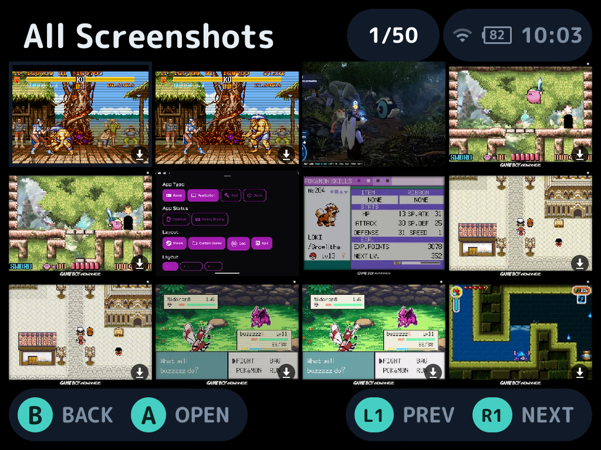
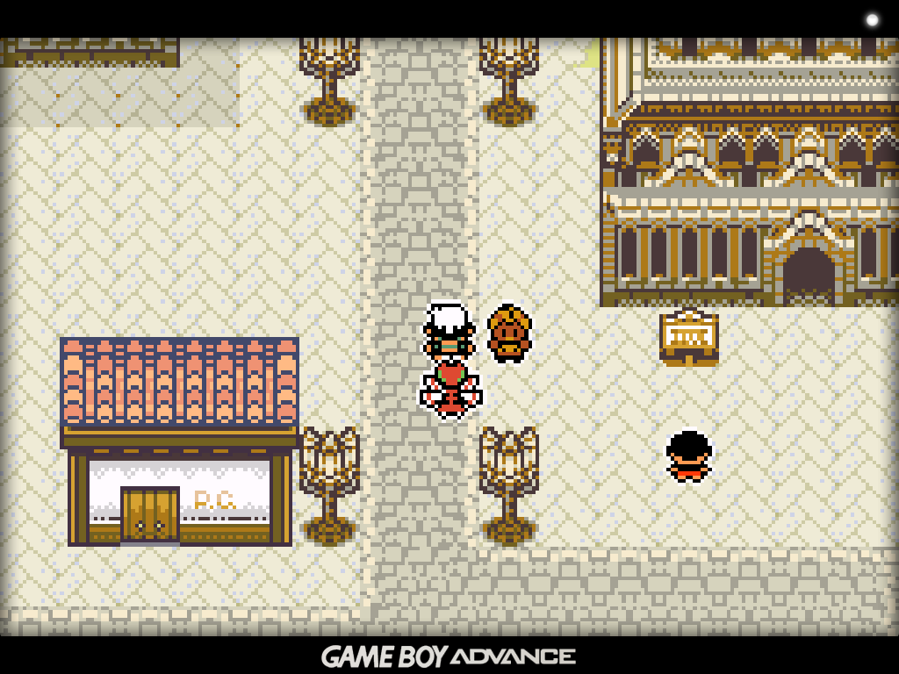
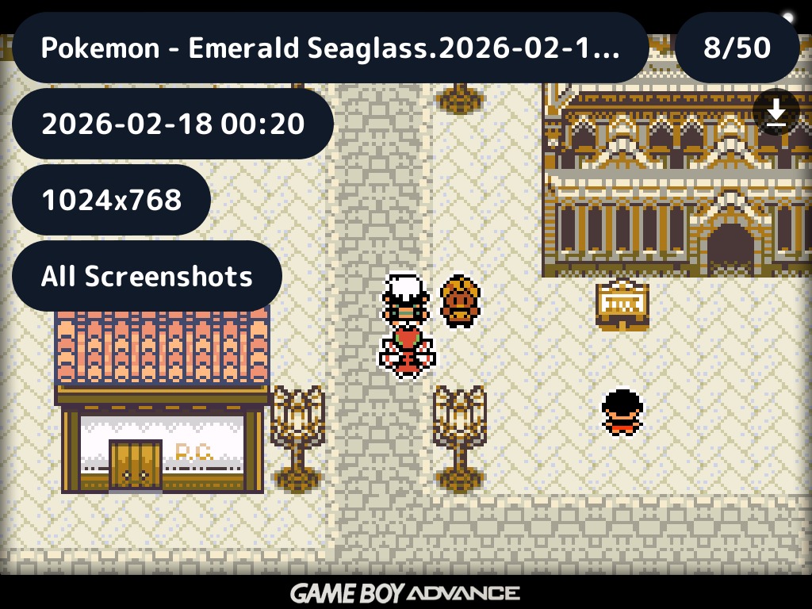
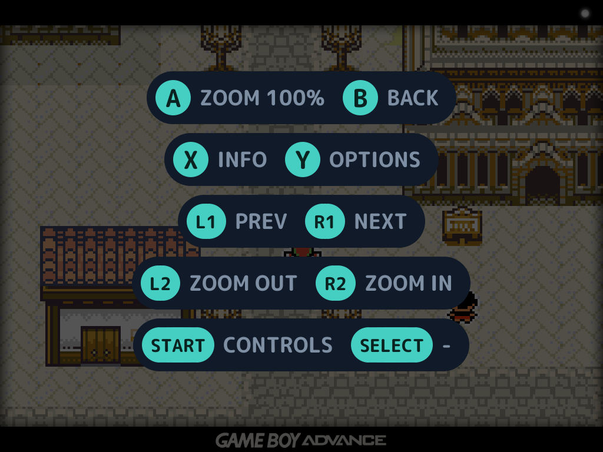
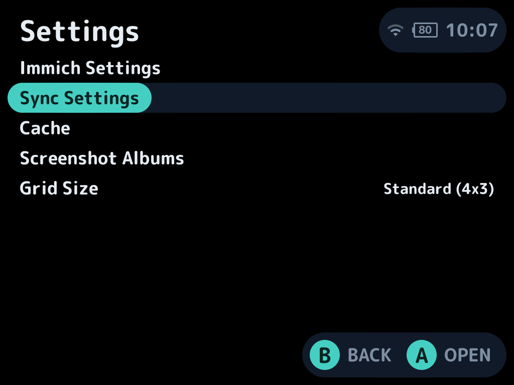
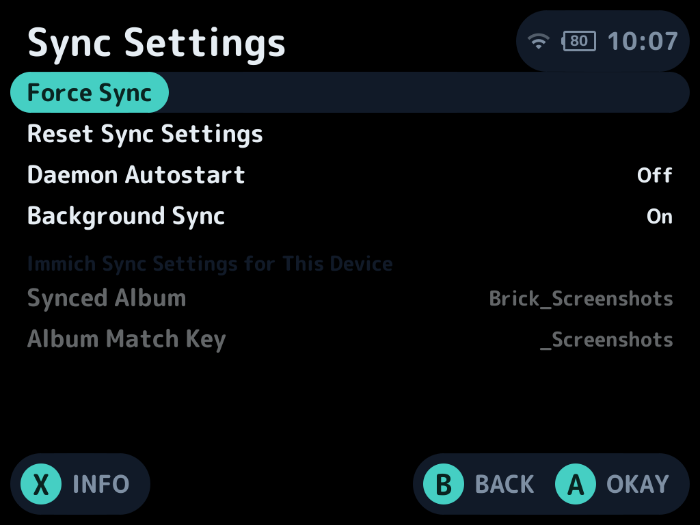
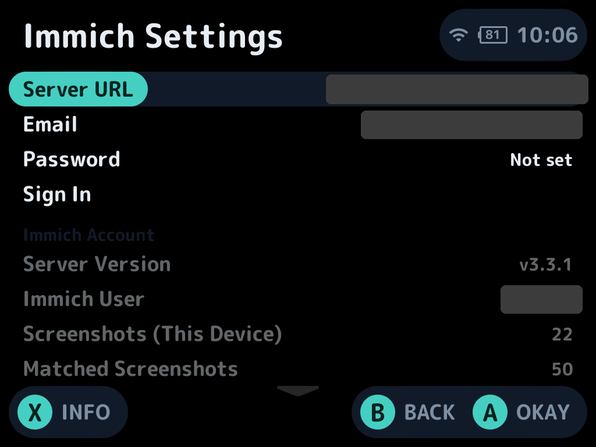
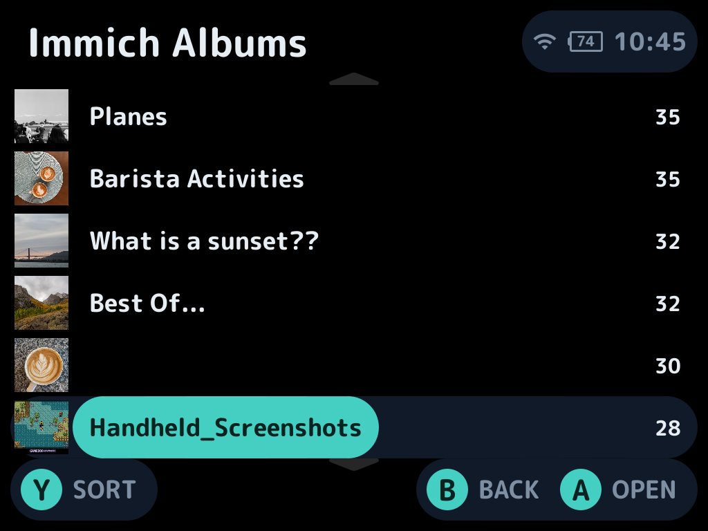

# Immich Sync for NextUI

A [NextUI](https://github.com/LoveRetro/NextUI) pak built to sync your retro gaming screenshots to your self-hosted [Immich](https://immich.app) server. Doubles as a basic image viewer.

| | |
|---|---|
|  |  |
| **Main menu** | **This Device**: this handheld's synced album merged with screenshots still on the card. ⬇ means the image is on the device, ☁ means it's uploaded. |
|  |  |
| **All Screenshots**: every device's screenshot album in one grid. | **Viewer**: Clean view by default. X for Info Overlay; START for Controls Overlay |
|  |  |
| **Info Overlay (X)** | **Controls (START)**: button mapping for the viewer. |
|  |  |
| **Settings** | **Sync Settings** |
|  |  |
| **Immich Settings**: sign in, plus account and storage details. | **Immich Albums**: every album on your server with cover thumbnails. |

## Features
- Automatically sync your Brick's screenshots with your Immich server
- Immich image browser with a download functional and basic on-device file management

## Setup

### Installation

1. Download `Immich.Sync.pak.zip` from the [latest release](https://github.com/amn-96/nextui-immich-screenshot-sync/releases/latest).
2. On your SD card, create `Tools/<platform>/Immich Sync.pak/`, using your device's platform folder from the [table above](#device-support). For example, use `Tools/tg5040/Immich Sync.pak/` on a Brick.
3. Unzip the contents into that folder.

The zip is the same for every device: it contains a binary for each platform, and the pak runs the one matching the device it's on. Only the folder you put it in depends on your device.

Pak store listing is pending.

### Quickstart
See [CONFIGURATION_GUIDE.md](CONFIGURATION_GUIDE.md) for more details.

#### Connecting to Immich
1. On the device, open **Tools > Immich Sync > Settings > Immich Settings**.
2. Enter your **Server URL**, **Email** and **Password**, then choose **Sign In**. The password is used once to create an API key; only the key is stored. 

If you'd prefer, you may use your own Immich API key directly. See [CONFIGURATION_GUIDE.md](CONFIGURATION_GUIDE.md).

#### Onboarding
1. Back on the main menu, open **This Device**. The first time, it asks for a name for this device. Screenshots upload to an Immich album named `<name><match key>`, e.g. `Brick_NextUI`. Keep the default match key `_NextUI` (case-sensitive) so the album also shows up in **All Screenshots** on your other devices. On the match key row, press left for `(none)` (no matching; the album is just `<name>` and only this device's album shows in **All Screenshots**) or right for **Custom...** to type your own key.
2. Optional: in **Settings > Sync Settings**, turn on **Daemon Autostart**. A background daemon then uploads new screenshots shortly after they're taken. It pauses during sleep and while a game is running (unless **Background Sync** is on). The daemon auto-runs the sync process 5s after wake with a retry at 30s in case wifi didn't connect; 5s after a game exits; and then on a stepped schedule afterwards.

Without the daemon, screenshots upload as soon as the app opens, or with **Force Sync**. The daemon is still in testing to find my preferred schedule and to characterize its impact on gaming and battery life. Preliminary testing shows 0 idle cpu usage and since it doesn't run when a game is active, it shouldn't impact performance. Large library syncs may take a while and drain your battery that way, but it should be safe. I plan to switch the daemon to `ON` by default in a future release soon.

The app never deletes anything on your Immich server.

## Device support

**This was developed and tested on the TrimUI Brick.** I've compiled builds for all other NextUI-supported devices but cannot test them because my only NextUI device is my Brick. I also have an H700 CubeXX but will need to grab some SD cards and time to test on that.

| NextUI platform | Devices | Status |
|---|---|---|
| `tg5040` | TrimUI Brick | Tested |
| `tg5040` | TrimUI Smart Pro | Untested (same binary, 1280x720 layout unverified) |
| `tg5050` | TrimUI Smart Pro S | Compiles, untested |
| `h700` | Anbernic RG35XX/RG40XX family | Compiles, untested |

If you're not on a Brick, the UI might break in some spots especially with text layouts. Reports from other devices are welcome via issues or discord -- please send screenshots if possible! 

## Build

Requires Docker and `git submodule update --init` (NextUI, cJSON, libwebp, SDL_ttf are pinned submodules under `vendor/`), plus `git -C vendor/SDL_ttf submodule update --init external/freetype`. The device's SDL_ttf is too old for emoji, so SDL_ttf 2.22 and its FreeType are built statically; `pak/NotoEmoji.ttf` (OFL) supplies the emoji glyphs.

    make          # build/tg5040/immich.elf in the tg5040 toolchain container
    make pak      # assemble "build/Immich Sync.pak" for PLATFORM
    make release  # pak with every platform's binary, zipped to build/Immich.Sync.pak.zip
    make pak PLATFORM=h700   # any target takes PLATFORM (tg5040, tg5050, h700)
    make shell    # interactive toolchain shell

## Releasing

Bump `version` (and `changelog`) in `pak.json`, commit, then push a matching tag, e.g. `git tag v1.0.1 && git push public v1.0.1`. GitHub Actions builds `Immich.Sync.pak.zip` and publishes the release; the tag must equal the `pak.json` version.

## AI Disclosure
This is AI-assisted af. I do have previous experience hand-writing little apps like this to talk to self-hosted services and my day job is a lot of Python (pre-AI and post-AI), but I haven't written anything in C since CS 101 so Claude did all the legwork to integrate with NextUI's tooling and libraries. I've reviewed the general structure of the code and all of the docs and functionality descriptions are proofed by me.

## Roadmap
- Daemon on by default (pending some testing)
- Test layout and functionality on my CubeXX
- See if anything can be done to make caching and loading faster. Screenshots are quick but if you have high res images like I do, it can be a bit slow. Not sure how much of this is just slow hardware...
- Test an actual Immich timeline view. I'm worried this'll chomp up all the Brick's RAM.
- Support for videos? Is that useful?
